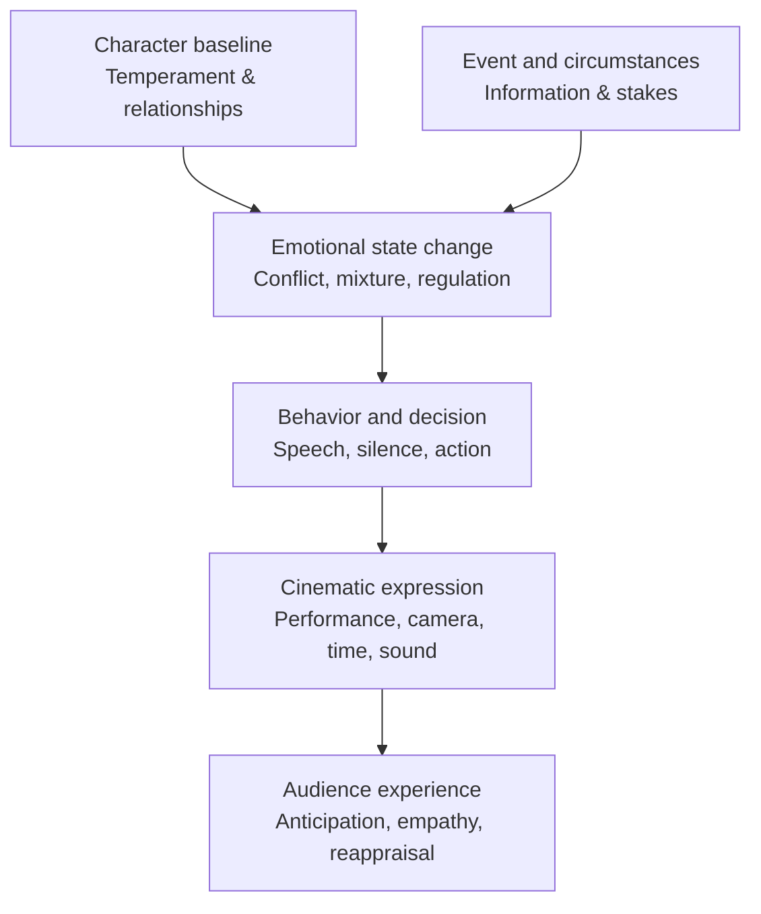
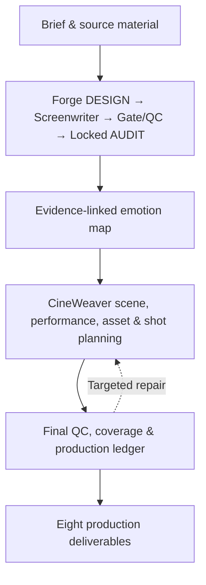

<p align="center">
  
</p>

<h1 align="center">AI Film Director · 4.7.1 Fusion</h1>
<p align="center"><strong>Emotion-Driven Narrative & Cinematic Intelligence Framework</strong></p>
<p align="center">从人物的内在情绪，到观众看见的故事。<br/>From inner emotional states to the stories an audience experiences.</p>

<p align="center">
  <a href="README.zh-CN.md">简体中文</a> · <a href="#the-emotional-causality-chain">English</a> · <a href="docs/ARCHITECTURE.md">Architecture</a> · <a href="docs/COMPARISON.md">Positioning</a> · <a href="LICENSE">Apache-2.0</a>
</p>

<p align="center">
  
  
  
  
</p>

> **The central question is not simply _“Can AI generate a shot?”_ It is _“Why should this character feel, decide and behave this way—and what should the audience experience as a result?”_**

AFD is a structured, agent-assisted film pre-production and directing framework. Its core is a **traceable emotional-causality chain** connecting character disposition, events, evolving internal states, behavioral expression, audience interpretation, and cinematic decisions.

It combines **Forge** (story, screenplay, emotional authority), **Human-Truth Screenwriter**, **CineWeaver** (scene intelligence, performance, assets, spatial reasoning and shot design), and **AFD MASTER ORCHESTRATOR** (state, approvals, quality gates, handoffs and exports).

**Status:** The repository provides real instructions, structured contracts, validators, renderers, a state machine, sample files and tests. **It is not a video-generation foundation model and does not independently render finished AI video, TTS or final audio.** Image generation is only available when the host supplies a real image tool.

## The emotional causality chain



Emotion is **not** a rigid mapping from a label to a facial expression. Anger can become confrontation, silence, concealment or restraint depending on the character, the relationship and the stakes. The system treats those distinctions as narrative choices that require screenplay evidence, not universal psychological laws.

The Forge emotional audit and audience-map renderer visualize **script-supported** states and transitions. Unknowns stay unknown; graphics cannot fabricate psychology or story facts.

## What distinguishes AFD's design

| Design principle | Practical consequence |
|---|---|
| **Emotion has causal context** | States are tied to what happened, what the character knows, and what action follows. |
| **Story authority is explicit** | Forge owns story and emotional truth; downstream film departments cannot silently rewrite a locked screenplay. |
| **Performance is more than a facial label** | Scene Intelligence and Director Craft reason about action, restraint, relationships, reaction, spatial behavior and micro-performance. |
| **Audiences are part of the design** | Information release, expectations, relationship payoffs and aftermath are considered alongside the character arc. |
| **Production is a checked state machine** | A 20-stage orchestrator enforces artifacts, gates, ownership and failure routing. |
| **Continuity is contractual** | Asset identity, screenplay locks, spatial relationships, shot/segment constraints and production history are validated. |
| **Revision targets the responsible layer** | Failed checks route work back toward a minimal affected owner rather than restarting every department. |

These are architectural commitments and implemented checks—not a claim that AFD has been proven superior in independent film-quality studies.

## How the system is organized



The orchestrator's **20 stages**, screenplay SHA256 lock, evidence-preserving Forge-to-AFD compiler, structural validation, renderer stages and eight-file export contract are described in [Architecture](docs/ARCHITECTURE.md).

### The production departments

| Department | Responsibility | Source |
|---|---|---|
| AFD MASTER ORCHESTRATOR | Stage order, lock policy, artifact checks, rerun routing | [`SKILL.md`](skills/ai-film-director-4/SKILL.md) and [`master_orchestrator.py`](skills/ai-film-director-4/scripts/master_orchestrator.py) |
| Forge | Story design, Human-Truth screenplay, Gate/QC, locked audit, emotional evidence | [`references/forge/`](skills/ai-film-director-4/references/forge/) |
| Emotion renderer | Character/audience emotional maps derived from audited facts | [`render_emotion_map.py`](skills/ai-film-director-4/scripts/render_emotion_map.py) |
| CineWeaver | Scene intelligence, performance, asset/spatial/shot contracts | [`references/cineweaver/`](skills/ai-film-director-4/references/cineweaver/) |
| AFD Production & QC | Continuity, coverage, model-aware prompts, validation, delivery | [`scripts/`](skills/ai-film-director-4/scripts/) |

## Eight formal production deliverables

1. Project requirements confirmation
2. Screenplay review and revision conclusion
3. Formal screenplay
4. Integrated director's screenplay
5. Dual-layer audience emotion map (HTML)
6. Asset library and detailed generation prompts
7. Formal storyboard and video-model prompts
8. Story coverage and production ledger (HTML)

Formal **project-complete** export requires the corresponding `FULL + PROJECT` checks to pass. A unit or pilot deliverable must not be presented as a completed feature or season.

## Get started

**Requirements:** Python 3.10+; a host agent able to read a skill and execute permitted local Python tools. Full regression tests require the packages listed in `requirements-test.txt`. Video/image generation tools are **external and optional**.

```bash
git clone https://github.com/xinsen854/AI-Film-Director.git
cd AI-Film-Director
python skills/ai-film-director-4/scripts/verify_release.py \
  --skill-root skills/ai-film-director-4 --skip-regression
```

For the complete regression gate:

```bash
python -m pip install -r skills/ai-film-director-4/requirements-test.txt
python skills/ai-film-director-4/scripts/verify_release.py \
  --skill-root skills/ai-film-director-4
```

Use the [`skills/ai-film-director-4/`](skills/ai-film-director-4/) directory as the installable skill in a compatible agent environment. The [`examples/sample_project/`](skills/ai-film-director-4/examples/sample_project/) folder contains an illustrative brief and storyboard, **not** evidence of an automatically produced final film. See [Architecture](docs/ARCHITECTURE.md) for the orchestration contract and approval behavior.

## Research and safety boundaries

- **Narrative model, not clinical inference:** AFD does not diagnose personality or predict real individuals' decisions with validated accuracy.
- **No invented evidence:** Unknown emotional states and unverified media must not be turned into asserted facts.
- **Human creative authority:** The default screenplay policy pauses for approval before lock (`REVIEW_BEFORE_LOCK`).
- **Model claims are conditional:** Video length limits, media roles and capabilities must be verified for the selected generation service.
- **Quality claims require evaluation:** Unit tests check programmatic contracts; they do not independently prove that scenes move viewers or outperform other film systems.

## Relationship to other projects

OpenMontage and StoryMind emphasize the **media production/execution** path; CineCrew emphasizes a film-oriented structured specification with feedback-driven visual repair; Continuity Studio emphasizes an inspectable **production and continuity workspace**. AFD's primary contribution is its **emotion-centered narrative/directing authority and gated pre-production contract**. These systems address overlapping but different layers, and no objective overall ranking is implied. See [Positioning](docs/COMPARISON.md) for citations to the original projects.

## Contributing and license

Issues and reproducible examples are welcome, particularly around evidence provenance, emotion-state representation, shot continuity, verification and model adapters. See [Contributing](CONTRIBUTING.md).

Licensed under [Apache License 2.0](LICENSE). The cinematic cover image in this repository was generated specifically for this release and is part of its visual documentation.
