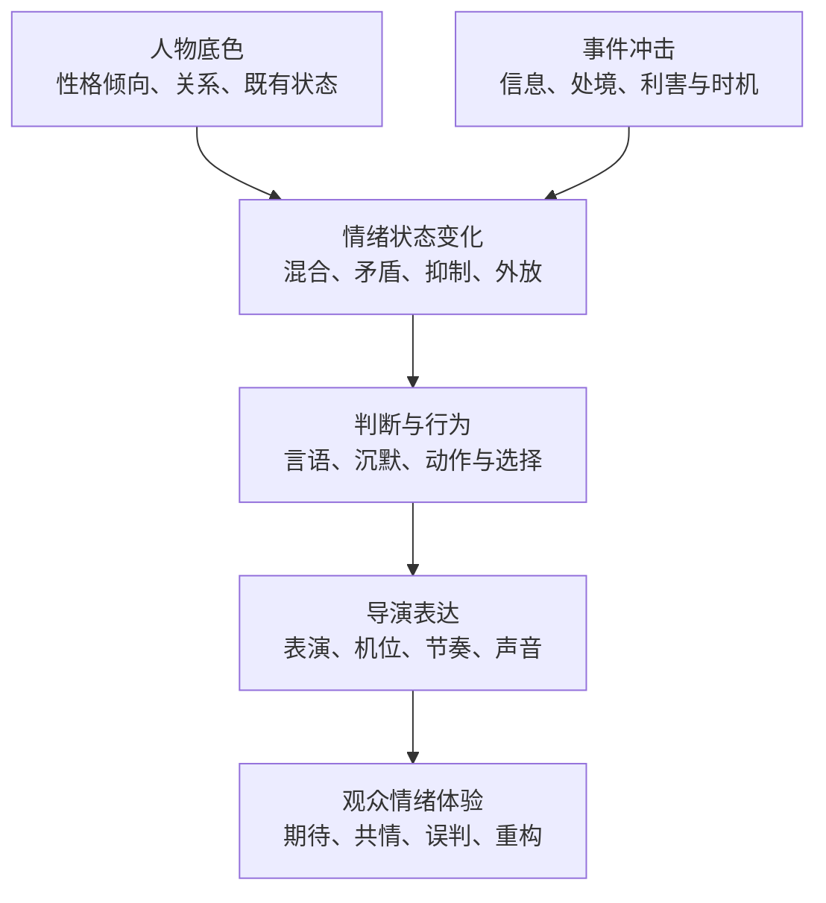
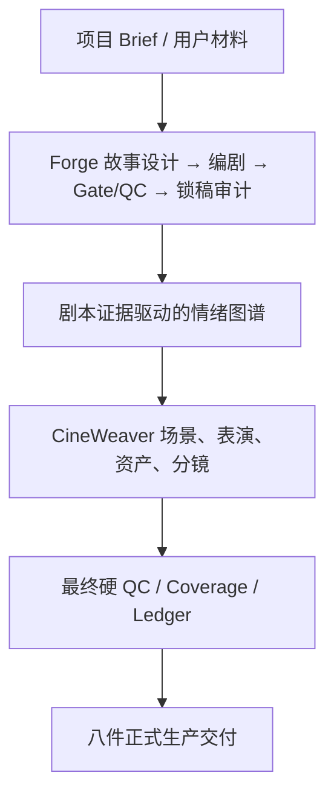

<p align="center"></p>

<h1 align="center">AI Film Director · 4.7.1 Fusion</h1>
<p align="center"><strong>情绪驱动的智能叙事与影视导演框架</strong></p>
<p align="center"><a href="README.md">English</a> · <a href="docs/ARCHITECTURE.md">技术架构</a> · <a href="docs/COMPARISON.md">与开源项目的定位比较</a> · <a href="LICENSE">Apache-2.0</a></p>

> 我们研究的首要问题，不是“AI 怎样生成一个镜头”，而是“人物为何产生这种情绪、作出这种选择；观众又为何会因此产生特定体验”。

**AFD 4.7.1 Fusion** 是一套面向 AI 影视创作的结构化叙事、导演和生产规划框架。它把**人物底色、事件冲击、情绪动态、行为决策、观众体验、导演视听表达**组织为可追踪、可验证、可修订的流程。

系统融合 **Forge**（故事、编剧、情绪权威）、**Human-Truth Screenwriter**、**CineWeaver**（导演、表演、资产、空间、分镜）和 **AFD MASTER ORCHESTRATOR**（状态、质量闸门、锁稿、交接与交付）。

**明确的能力边界：** 当前版本能生成结构化生产文件、资产和视频提示词，并运行对应校验及渲染程序；**尚未内置完整的视频生成、TTS 或最终音频执行链**。存在视频模型 Prompt 并不代表已经生成影片。

## 一、情绪是系统的组织核心



这不是“愤怒就皱眉”“悲伤就哭”的标签匹配。相同的愤怒可能表现为反击、压抑、冷处理或克制，取决于人物关系、现实处境、已知信息及行为代价。情绪建模的输入必须有故事证据，不能把心理猜测伪装成确定事实。

情绪图谱也不是装饰：Forge 锁稿审计确定可引用的情绪事实，Renderer 再据此显示人物情绪变化、观众情绪阶段与事件驱动关系。脚本未提供的情绪事实保留未知状态。

## 二、六项核心设计

| 设计 | 解决的问题 |
|---|---|
| **情绪因果链** | 情绪变化需要事件、信息、人物目标和行为结果支撑，避免无缘无故的情绪转折。 |
| **情绪到表演的转译** | 把情绪、克制、关系和行为转化为具体表演动作及导演处理，而不止是表情词。 |
| **观众情绪机制** | 同时考虑信息揭露、悬念、选择代价、关系兑现及情绪余波。 |
| **创作权威分工** | Forge 决定故事与情绪事实，AFD/CineWeaver 负责下游导演与生产，不允许未经授权改写锁稿剧情。 |
| **20阶段状态机** | 每阶段绑定真实交付物、执行质量检查，失败按责任层进行局部返工。 |
| **资产、空间与镜头合同** | 用结构化规则约束人物身份、道具、连续性、镜头组织和视频模型提示词。 |

这些是源码中能够检查的架构和规则，**不等于已经通过独立观众实验或相同剧本盲测证明影视质量优于其他系统**。

## 三、整体架构



关键机制：

- **唯一公开入口**：`AFD MASTER ORCHESTRATOR` 管理 20 阶段和任务路由。
- **剧本锁定**：锁稿正文和 SHA256 绑定，下游修改剧情事实必须重新经过相应审批和 QC。
- **确定性桥接**：Forge → AFD 的编译桥接负责校验、映射和落盘，不擅自补写故事意义。
- **严格生产记录**：`Production Ledger`、`Story Coverage`、资产和分镜校验器配合使用。
- **情绪可视化**：角色与观众情绪变化以剧情证据为基础，非自动心理诊断。

模块和实现路径请看 [技术架构](docs/ARCHITECTURE.md)，入口技能为 [`skills/ai-film-director-4/SKILL.md`](skills/ai-film-director-4/SKILL.md)。

## 四、八件正式交付

1. 项目需求确认单
2. 剧本审查与修改结论
3. 正式编剧剧本
4. 整合导演剧本
5. 双层情绪规划图（HTML）
6. 资产总表与详细生成提示词
7. 正式分镜与视频模型最终 Prompt
8. Story Coverage / Production Ledger（HTML）

只有通过 `FULL + PROJECT` 范围的相关闸门后，才能宣称项目级正式交付完成。局部单元和试播生产不等于整片完成。

## 五、快速开始

需要 Python 3.10+，以及可以读取 Skill、运行本地 Python 的 AI Agent 环境。图像和视频生成模型不随本仓库附带。

```bash
git clone https://github.com/xinsen854/AI-Film-Director.git
cd AI-Film-Director
python skills/ai-film-director-4/scripts/verify_release.py \
  --skill-root skills/ai-film-director-4 --skip-regression
```

完整回归检查：

```bash
python -m pip install -r skills/ai-film-director-4/requirements-test.txt
python skills/ai-film-director-4/scripts/verify_release.py \
  --skill-root skills/ai-film-director-4
```

将 [`skills/ai-film-director-4/`](skills/ai-film-director-4/) 作为技能目录安装到兼容的 AI Agent 中。示例见 [`examples/sample_project`](skills/ai-film-director-4/examples/sample_project/)。示例中的分镜数据是演示资料，不能冒充真实生成的成片。

## 六、与现有开源 AI 影视项目的关系

OpenMontage、StoryMind 更强调视频实际生产和剪辑；CineCrew 更强调可操作的电影结构描述和视觉反馈修复；Continuity Studio 更强调可查看、可管理的连续性工作台。**AFD 主要强调情绪驱动的故事/导演权威和可验证的前期生产合同。** 这些不是经统一实验得出的优劣排名。详见[比较说明](docs/COMPARISON.md)。

## 七、研究边界与开源协议

- AFD 是叙事设计模型，不能声称准确预测现实人物的行为，也不能替代心理学临床工具。
- 程序测试可以检验格式、状态及交接规则，不能直接证明观众必然被某个情节打动。
- 未接入的媒体生成服务不能假装已经完成出图、配音或视频。
- 锁稿默认采用 `REVIEW_BEFORE_LOCK`，保留人的创作审批权。

项目采用 [Apache License 2.0](LICENSE)。欢迎就情绪因果、表演建模、连续性、验证方法与模型适配提交 Issue 和可复现案例。参见 [贡献指南](CONTRIBUTING.md)。
