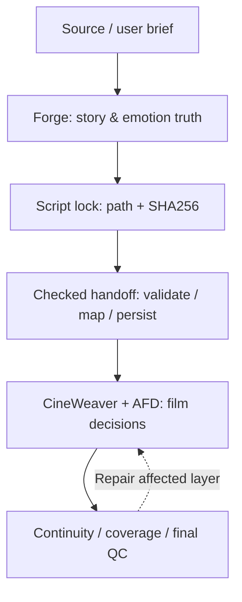

# AFD 4.7.1 Fusion — Technical Architecture

[Home](../README.md) · [Chinese edition](ARCHITECTURE.zh-CN.md)

## Why the system starts with emotion

The architecture treats character and audience emotion as **narrative state with causal evidence**, not as a collection of evocative adjectives. There are three distinguishable concerns:

1. **Character state:** disposition, relationships, knowledge, perceived stakes and emotional change after an event.
2. **Behavioral expression:** whether a character externalizes, suppresses, redirects or controls a response, and what the screenplay actually establishes.
3. **Audience state:** what the audience knows, expects and can infer, and how narrative information and film language may shape the intended experience.

These are **creative hypotheses**, not empirically calibrated personality predictions. The script and locked audit are the authority for downstream representation. The renderers do not create evidence.

## The 20-stage production authority chain

| Stage | Owner / result |
|---|---|
| 01 | AFD Project Intake |
| 02 | Forge DESIGN |
| 03 | Deterministic design handoff compiler |
| 04 | Project creative bible |
| 05 | Human-Truth Screenwriter |
| 06 | Forge Gate / QC / De-AI |
| 07 | Screenplay lock controller |
| 08 | Forge locked-screenplay AUDIT |
| 09 | Deterministic locked-audit handoff |
| 10 | Forge emotion renderer |
| 11 | CineWeaver Scene Intelligence |
| 12 | Capability Router |
| 13 | Director Craft |
| 14 | AFD Scene Direction |
| 15 | CineWeaver Asset Engine / AFD asset execution |
| 16 | Spatial Narrative (conditional) |
| 17 | Shot / Segment Engine |
| 18 | Final hard QC |
| 19 | Production Ledger |
| 20 | Eight-file export |

The source of truth is [`SKILL.md`](../skills/ai-film-director-4/SKILL.md), including detailed contracts and stage transitions. The state machine is implemented in [`master_orchestrator.py`](../skills/ai-film-director-4/scripts/master_orchestrator.py).

## Authority and invariants



- **Forge owns story and emotional meaning.** Downstream systems may express it cinematically but cannot rewrite it.
- **Human-Truth owns screenplay authorship** within the user's requested adaptation scope.
- **A lock is a real file/hash binding.** A changed lock candidate re-enters Gate/QC.
- **The bridge is not a new author.** Missing semantics block rather than get fabricated.
- **A PASS needs a real artifact.** Nonexistent, empty or out-of-project artifacts must fail validation.
- **Full completion is scope-sensitive.** Only `FULL + PROJECT` can claim the eight-file project-level export.

## Evidence, emotion and visual rendering

The emotional audit is downstream of a locked screenplay. The production pipeline can render a dual-layer audience/character emotion HTML view from the validated Forge audit. The visual language is meant to expose information, change and uncertainty; visual interpolation must not invent emotional causes or replace scene evidence.

Relevant sources:

- [`references/libraries/audience-emotion-mechanisms.json`](../skills/ai-film-director-4/references/libraries/audience-emotion-mechanisms.json): narrative causal mechanisms, applicability and failure conditions.
- [`references/forge/`](../skills/ai-film-director-4/references/forge/): story, locked audit and emotional evidence contracts.
- [`scripts/render_emotion_map.py`](../skills/ai-film-director-4/scripts/render_emotion_map.py): audited emotion-map renderer.
- [`scripts/compile_forge_handoff.py`](../skills/ai-film-director-4/scripts/compile_forge_handoff.py): evidence-preserving bridge.

## Production contracts

| Contract | Primary implementation |
|---|---|
| Artifact/state | [`schemas/master_orchestrator_state.schema.json`](../skills/ai-film-director-4/schemas/master_orchestrator_state.schema.json) |
| Screenplay authority / information ledger | [`schemas/story_authority.schema.json`](../skills/ai-film-director-4/schemas/story_authority.schema.json) |
| Asset identity and lineage | [`Asset Engine V4.1`](../skills/ai-film-director-4/references/cineweaver/Asset_Engine_V4.1/) |
| Shot and segment design | [`Shot Segment Engine V1.3`](../skills/ai-film-director-4/references/cineweaver/Shot_Segment_Engine_V1.3/) |
| Continuity and final quality | [`Final QC Engine V1.3`](../skills/ai-film-director-4/references/cineweaver/Final_QC_Engine_V1.3/) |
| Rendering and exports | [`scripts/run_pipeline.py`](../skills/ai-film-director-4/scripts/run_pipeline.py) |

## Execution and evaluation limits

The orchestrator, structural schemas, validators and renderers are executable. Narrative generation still depends on an LLM host correctly following the skill; the repository does not ship a trained emotion model or a media-generation backend. The video-generation provider, available media roles and call-duration limits must be checked at execution time.

Run the release gate from the repository root:

```bash
python skills/ai-film-director-4/scripts/verify_release.py \
  --skill-root skills/ai-film-director-4 --skip-regression
```

For a full regression run, first install `skills/ai-film-director-4/requirements-test.txt` and omit `--skip-regression`.

The validators prove contract consistency and guard specific regressions. They do **not** constitute a blind comparison of audience emotion, dramaturgy or cinematic quality; such claims require controlled human evaluation.
