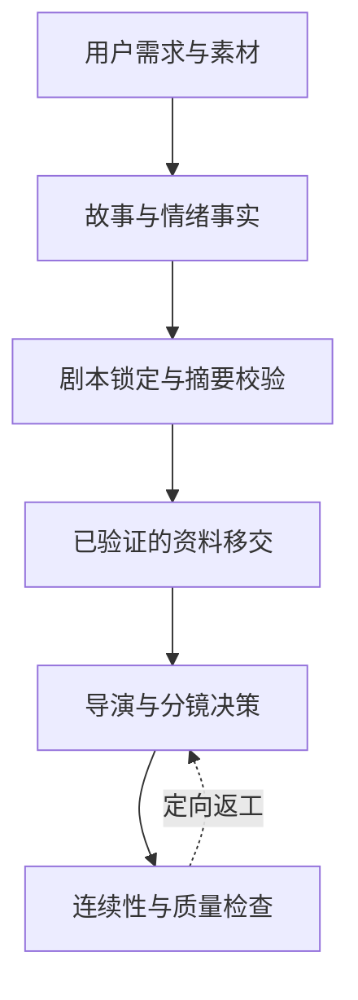

# 人工智能电影导演 4.7.1 融合版：技术架构

[中文首页](../README.zh-CN.md) · [英文版](ARCHITECTURE.md)

## 一、为什么以情绪为起点

系统把人物和观众的情绪视为**必须有叙事证据支持的动态状态**，而不是几个形容词。分析时区分三个层次：

1. **人物状态**：性格倾向、关系、掌握的信息、对事件代价的理解，以及事件发生后的情绪变化。
2. **行为表达**：人物是外放、抑制、转移还是控制反应；剧本实际交代了什么行为。
3. **观众状态**：观众知道什么、期待什么、可能作出怎样的判断；信息安排与视听表达希望带来什么体验。

这些属于影视创作假设，不是经过科学标定的人格预测。锁定的剧本及其审计结果是后续模块的事实依据；图谱渲染器不能凭空创造证据。

## 二、二十阶段生产链

| 阶段 | 主责工作或结果 |
|---|---|
| 01 | 项目需求接收 |
| 02 | 故事工坊：故事设计 |
| 03 | 设计资料的确定性移交 |
| 04 | 项目创作总纲 |
| 05 | 人性真实编剧 |
| 06 | 剧本审查、质量检查和去模板化修订 |
| 07 | 剧本锁定控制 |
| 08 | 锁稿后的故事与情绪审计 |
| 09 | 锁稿审计结果的确定性移交 |
| 10 | 情绪图谱渲染 |
| 11 | 场景智能分析 |
| 12 | 模型能力路由 |
| 13 | 导演技法规划 |
| 14 | 场景导演设计 |
| 15 | 资产设计与执行 |
| 16 | 空间叙事（按条件启用） |
| 17 | 镜头与片段规划 |
| 18 | 最终严格质量检查 |
| 19 | 生产台账 |
| 20 | 八件正式文件导出 |

具体阶段规则以 [`SKILL.md`](../skills/ai-film-director-4/SKILL.md) 为准；状态机实现在 [`master_orchestrator.py`](../skills/ai-film-director-4/scripts/master_orchestrator.py)。

## 三、权责关系与不变量



- **故事工坊负责剧情及情绪事实**，下游可以把它转化为电影表达，但不能擅自改写。
- **编剧模块负责剧本创作**，创作范围以用户批准的要求为界。
- **剧本锁定绑定实际文件与校验摘要**，内容变更需要重新审查。
- **模块交接不能编造缺失信息**；无法确定的含义应阻止后续流程或提示补充材料。
- **通过检查必须存在真实交付物**，不存在、空白或不属于本项目的文件均不能通过。
- **完整项目与局部单元分开验收**，只有完整项目通过相应检查才能宣称八件正式交付完成。

## 四、情绪证据与可视化

情绪审计以锁定剧本为依据，系统可以根据经检查的审计资料生成双层人物／观众情绪网页图谱。可视化应暴露信息、变化和不确定性，不能通过插值或补写创造事件与情绪原因。

核心源码：

- [观众情绪机制库](../skills/ai-film-director-4/references/libraries/audience-emotion-mechanisms.json)：叙事因果机制、适用条件及失效条件。
- [故事工坊参考资料](../skills/ai-film-director-4/references/forge/)：故事、锁稿审计与情绪证据规则。
- [情绪图谱渲染器](../skills/ai-film-director-4/scripts/render_emotion_map.py)：根据审计数据生成可视化。
- [资料移交编译器](../skills/ai-film-director-4/scripts/compile_forge_handoff.py)：保留证据的校验与映射。

## 五、生产合同与实现

| 生产约束 | 主要实现 |
|---|---|
| 交付物与状态 | [总调度器状态结构](../skills/ai-film-director-4/schemas/master_orchestrator_state.schema.json) |
| 剧本权威与信息记录 | [故事权威结构](../skills/ai-film-director-4/schemas/story_authority.schema.json) |
| 资产身份与继承关系 | [资产引擎](../skills/ai-film-director-4/references/cineweaver/Asset_Engine_V4.1/) |
| 镜头与片段设计 | [镜头片段引擎](../skills/ai-film-director-4/references/cineweaver/Shot_Segment_Engine_V1.3/) |
| 连续性和最终检查 | [最终质量检查引擎](../skills/ai-film-director-4/references/cineweaver/Final_QC_Engine_V1.3/) |
| 渲染与导出 | [流程执行脚本](../skills/ai-film-director-4/scripts/run_pipeline.py) |

## 六、运行与评估边界

总调度器、数据结构、校验器及图谱渲染器可以运行；叙事生成仍依赖能够遵循技能规则的大语言模型运行环境。本仓库不附带已训练的情绪基础模型，也不附带独立的视频生成后端。具体媒体模型的能力和单次时长限制须在使用时核实。

在仓库根目录执行基础发布检查：

```bash
python skills/ai-film-director-4/scripts/verify_release.py \
  --skill-root skills/ai-film-director-4 --skip-regression
```

完整回归测试需先安装 `skills/ai-film-director-4/requirements-test.txt` 中的依赖，再执行不带 `--skip-regression` 的命令。

程序校验可以检查结构一致性和特定回归问题，**不能代替观众盲测，也不能证明影视感染力或情绪预测准确率**。
